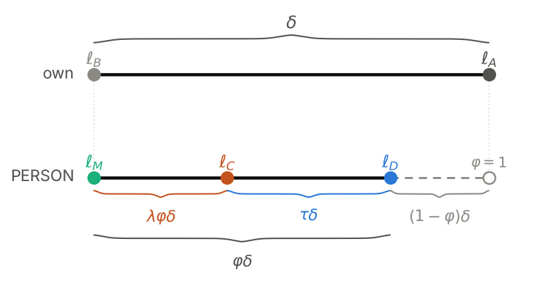

# Second-order beliefs in language models

When a model reports what someone else believes, how much of its own private evidence leaks in?
This repository measures that *curse of knowledge* in Qwen3 8B and 14B, building on Smolin and
Wilder, *Beliefs and Behavior in Language Models*
([arXiv:2609.07943](https://arxiv.org/abs/2609.07943)).

## The experiment

The model reads a patient's record. PERSON (a named person; the name varies by patient) has a
record of the same patient that is missing some fields.

| We ask the model | Condition | Example |
| --- | --- | --- |
| Its own view, from the full record | A | 30% |
| Its own view, from PERSON's record | B | 12% |
| What PERSON thinks; both records shown, both PERSON's | M2 | 13% |
| What PERSON thinks; it has the full record, PERSON the partial one | C | 25% |
| What PERSON thinks; both records shown, both full | D2 | 28% |

**Leakage** $\lambda$ is where C falls between its two references in log-odds $\ell$: $0$ means
the model kept its private evidence out of PERSON's belief, $1$ means it all leaked in. Here
$\lambda = (\ell_C - \ell_{M2})/(\ell_{D2} - \ell_{M2}) \approx 0.84$; people score about $0.51$
(Camerer, Loewenstein and Weber, 1989). The single-record references M and D (only PERSON's record
shown) give the Methods' version of the same estimate.



Across cases, with $x = \ell_A - \ell_B$ and $x'$ the same gap from a second, independent run:

$$
\lambda = \frac{\beta_C}{\beta_D}, \qquad
\rho = \frac{\mathrm{Cov}(x, x')}{\mathrm{Var}(x)}, \qquad
\varphi = \frac{\beta_D}{\rho}, \qquad
\tau = \varphi\,(1 - \lambda),
$$

where $\beta_C$ and $\beta_D$ are the slopes of $\ell_C - \ell_M$ and $\ell_D - \ell_M$ on $x$, with M and D
the reference pair. $\rho$
corrects for noise in $x$, $\varphi$ is how strongly PERSON's belief follows the evidence (shared by
the two settings below), and $\tau$ is a theory-of-mind score.

The study runs two settings, PERSON missing evidence and PERSON given altered evidence, on two
datasets in [`datasets/`](datasets): 150 kidney-disease patients, each asked the paper's 16
questions, and 20 fictional puzzles with known Bayes answers. The design is in
[`docs/design.md`](docs/design.md) and the data in [`docs/data.md`](docs/data.md).

## Running it

On a Linux machine with a GPU:

```bash
git clone https://github.com/mangoseller/model_beliefs && cd model_beliefs
bash run_experiment.sh --smoke                    # quick check on 20 cases
nohup bash run_experiment.sh > run.out 2>&1 &     # the full run
```

This installs everything, runs the experiment on both models, and packages the results as
`runs/<run_id>.tar.gz`. Start with `RUN_REPORT.md` inside it. Details are in
[`docs/running.md`](docs/running.md).

## Layout

```
second_order/      the experiment, and its config.yaml
datasets/          the two datasets, sent verbatim
latent_beliefs/    the paper's replication package (latent_beliefs/README.md)
first_order/       first-order belief readouts on small models (first_order/README.md)
docs/              design, running, data formats
tests/             unit and end-to-end tests
requirements/      pinned dependencies for run_experiment.sh
```

`data/`, `outputs/`, `figures/` and `runs/` are created by runs and are not in git.
