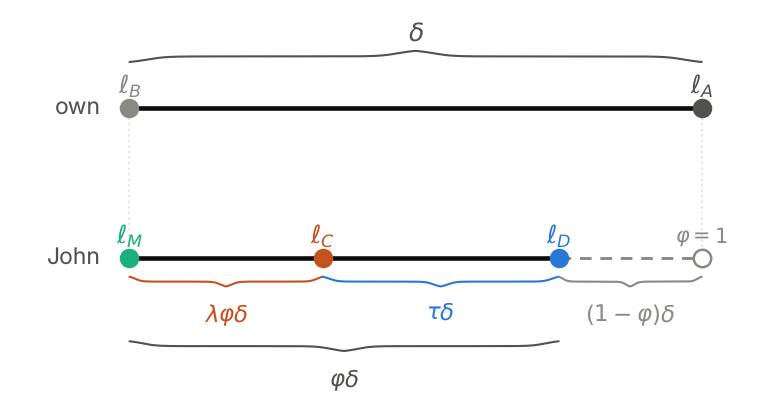

# Second-order beliefs in language models

When a model reports what someone else believes, how much of its own private evidence leaks in?
This repository measures that *curse of knowledge* in Qwen3 8B and 14B, building on Smolin and
Wilder, *Beliefs and Behavior in Language Models*
([arXiv:2609.07943](https://arxiv.org/abs/2609.07943)).

## The experiment

The model reads a patient's chart. John, a physician as capable as the model, has a copy that
is missing some fields.

| We ask the model | Condition | Example |
| --- | --- | --- |
| Its own view, from the full chart | A | 30% |
| Its own view, from John's copy | B | 12% |
| What John thinks; it sees only John's copy | M | 13% |
| What John thinks; it sees the full chart | C | 25% |
| What John thinks, if John had the full chart | D | 28% |

**Leakage** $\lambda$ is where C falls between M and D in log-odds $\ell$: $0$ means the model
kept its private evidence out of John's belief, $1$ means it all leaked in. Here
$\lambda = (\ell_C - \ell_M)/(\ell_D - \ell_M) \approx 0.84$; people score about $0.51$
(Camerer, Loewenstein and Weber, 1989).



Across cases, with $x = \ell_A - \ell_B$ and $x'$ the same gap from a second, independent run:

$$
\lambda = \frac{\beta_C}{\beta_D}, \qquad
\rho = \frac{\mathrm{Cov}(x, x')}{\mathrm{Var}(x)}, \qquad
\varphi = \frac{\beta_D}{\rho}, \qquad
\tau = \varphi\,(1 - \lambda),
$$

where $\beta_C$ and $\beta_D$ are the slopes of $\ell_C - \ell_M$ and $\ell_D - \ell_M$ on $x$. $\rho$
corrects for noise in $x$, $\varphi$ is how strongly John's belief follows the evidence, and $\tau$
is a theory-of-mind score.

The study runs two settings, John missing evidence and John told something false, on two
datasets: the paper's 500 kidney-disease cases and a set of fictional puzzles with known Bayes
answers ([`docs/BESPOKE.md`](docs/BESPOKE.md)). The full design is in
[`docs/IMPLEMENTATION_NOTES.md`](docs/IMPLEMENTATION_NOTES.md).

## Running it

On a Linux machine with a GPU:

```bash
git clone https://github.com/mangoseller/model_beliefs && cd model_beliefs
bash run_experiment.sh --smoke                    # quick check on 20 cases
nohup bash run_experiment.sh > run.out 2>&1 &     # the full run
```

This installs everything, runs the experiment on both models, and packages the results as
`runs/<run_id>.tar.gz`. Start with `RUN_REPORT.md` inside it. Put the puzzle set at
`data/bespoke/items.yaml` first; without it, a placeholder is used. Details are in
[`docs/RUNBOOK.md`](docs/RUNBOOK.md).

## Layout

```
second_order/        the experiment
latent_beliefs/      the paper's replication package (unchanged; docs/REPLICATION.md)
model_beliefs/       first-order belief readouts on small models (model_beliefs/README.md)
configs/             every setting of the experiment
docs/                runbook, implementation notes, data formats
tests/               unit and end-to-end tests
```
