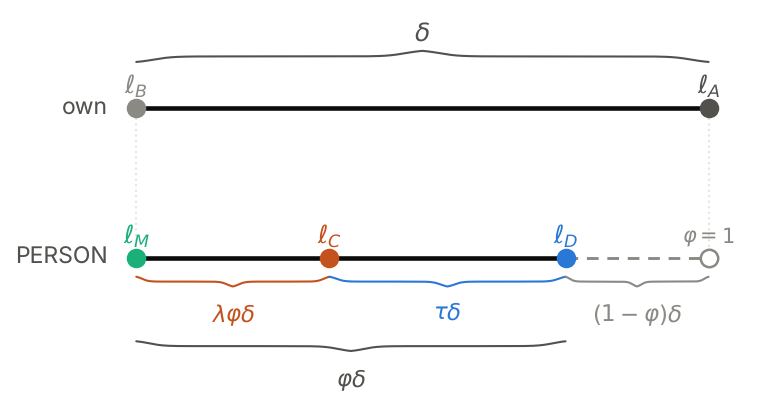

# Implementation notes: the second-order experiment

A neutral record of how `second_order/` is built, the choices behind it, and
what has been validated. Commands are in `docs/RUNBOOK.md`; the first-order
code is mapped in `docs/ORIENTATION.md`. `latent_beliefs/` is untouched, and
`python -m second_order.baseline_check` confirms the first-order numbers
still reproduce.

## The curse-of-knowledge experiment

The current study (Qwen3 8B and 14B) measures the leakage rate λ in two
settings, partial evidence (pair `S4`) and false belief (pair `F`). It uses
two datasets, CKD and the bespoke items (`docs/BESPOKE.md`), and two belief
methods, the latent fit ("Bayesian marginalization") and the stated
probability (direct elicitation).

- **Conditions.** `A B C_john M_S4 D_john` (partial) and `B_F C_F M_F D_F`
  (false belief); `experiment.conditions`.
- **`D_F`** is the false-belief setting's own D. C_F, M_F and D_F all frame
  the agent's evidence as reported by a colleague
  (`false_belief_framing: reported`). M_F and D_F share one sentence, so M
  and D still differ only in the evidence shown. Runs without D_F fall back
  to the shared D.
- **Same suffix.** Own-belief prompts use `self_layout: matched`: the layout
  of the prompts about the agent, without the agent paragraph. A, B, C, M
  and D therefore end with the same question and answer format. Models whose
  A comes from the release keep the first-order layout.
- **Second run.** A, B and B_F run twice (`experiment.replicates`). The two
  independent gaps x and x′ give the reliability ρ. In the latent fit the
  second run is extra rows of the "self" family.
- **Samples.** Bespoke items get `bespoke.samples` samples per condition and
  run. A belief is the mean sample logit; its `sd` is the standard error.
- **Comprehension.** After each C answer (CKD: the numeric probability only),
  a second turn asks which evidence the agent had. The turn replays the C
  prompt and response verbatim on every backend. Answers are parsed
  strictly and scored. Only answered follow-ups count: an unparseable answer
  is wrong, and a follow-up not yet generated is missing. `outputs/curse/`
  reports accuracy, and estimates restricted per C condition to correct
  answers. CKD drops the case from that setting only; bespoke drops the
  sample.
- **Bespoke parsing.** Answers are read from the JSON object only. The
  first-order fallback (a number after the word "probability") would read
  "the probability that ... Bag 1" as 1.
- **Generation** for the Qwen models is local:
  - `vllm`: one seed per item, temperature 1, thinking off;
  - `hf` fallback;
  - `synthetic`: text written from known parameters.

  Each Qwen model has its own seeded train/validation/test split
  (`split: own`), because there is no first-order Qwen3 8B/14B data to
  borrow one from.

### Estimators

With x = l_A − l_B:

- β_D is the slope of (l_D − l_M) on x, and β_C the slope of (l_C − l_M) on x.
- λ = β_C / β_D. This is identical to the matched-control λ = 1 − T_C/T_M
  already in `leakage.py`, because β_D = T_M and β_C = T_M − T_C exactly.
- ρ = Cov(x, x′) / Var(x).
- φ = β_D / ρ and τ = (β_D − β_C) / ρ = φ(1 − λ).

φ, τ and ρ use `value_calibrated`. For latents, the posterior means of the
"self" and "john" fits shrink by different amounts, and that would scale φ;
λ is a ratio of slopes from one fit and is unaffected. φ is reported per
setting, pooled across settings (`phi_pooled`: within-setting slopes, so each
setting keeps its intercept), and as the false − partial difference.

The earlier halves-based companions are kept as `kappa_halves` and
`tau_halves`.

### Checks of the modelling assumptions

| Assumption | Check |
|---|---|
| 1, affine | Slopes of l_D on l_A and of l_M on l_B, each instrumented by the second run. Both estimate φ without using the gap. Quadratic terms of both gap regressions. |
| 2, partial linearity | λ for positive and negative gaps separately; λ by thirds of \|x\|. |
| 3, independent noise | ρ comes from independent calls. On the bespoke set, placebo items should show zero gaps. |
| All | `bespoke.checks` keeps Bayes answers inside [0.05, 0.95], where the 0.01/0.99 logit clip does not bind. |

### Validation

- Unit tests recover λ, ρ, φ and τ under measurement noise large enough to
  attenuate β_D. They also check that φ reads calibrated values and that the
  ratio rule blanks φ when the second run carries no signal.
- `tests.test_pipeline` runs the whole pipeline on the synthetic backend:
  generation, parsing (with planted parse failures and `<think>` tags),
  latent fits, beliefs, estimators, report and figures. It checks that the
  planted λ (both settings, both datasets, both methods), φ, τ, the
  comprehension accuracy and a Bayesian own belief are recovered.

### The runner

`run_experiment.sh` and `second_order/runner.py` run everything; the RUNBOOK
lists the stages.

- **The run's config.** Every run writes its own `config.yaml` (the
  repository config plus the run's choices). Every stage reads it, so it is
  the record of what ran.
- **Pinned snapshots.** The fetch stage pins the Hugging Face snapshot hash
  of each model in that config, and later stages run offline against those
  files.
- **Tuning.** `tune` times vLLM engine settings: concurrent sequences, the
  per-step token budget, the KV-cache memory share, prefix caching. These
  change speed, not the sampling distribution, so they are not part of the
  cache's settings check.
- **Smoke test.** The same benchmark calls are checked for parse rate and
  truncation, so a broken setup stops before the long generation.
- **Frozen activations.** `freeze` replays each prompt and its cached
  response through transformers. A response is re-tokenised from its text,
  which can differ from vLLM's original token split by a token at the
  boundary; the positions are found from character offsets. Activations
  are bfloat16 bit patterns (no rounding). The CKD profile and bespoke
  evidence come before the agent paragraph, so `evidence_end` is the same
  token across conditions that show the same evidence.

## The earlier RQ1–RQ3 design (deprecated)

The sections below describe the condition table, prompts, generation,
fits and estimators shared by both designs, then the deprecated design's own
analyses: coherence, probes and the pilot, whose code is in
`second_order/deprecated/`.

## Conditions

All conditions live in one table, `second_order/conditions.py`. Each has a
**role**, a **framing** (the model itself, PERSON, or the user) and a **pair**. PERSON is the
agent whose belief is asked about; the prompts currently name them John.

| Role | Whose belief | Model is shown | Agent holds |
|---|---|---|---|
| A | The model's own | Full profile | n/a |
| B | The model's own | The agent's copy | n/a |
| C | The agent's | Full profile | A different copy |
| M | The agent's | The agent's copy only | That same copy |
| D | The agent's | Full profile | Full profile |

A pair says how the agent's copy differs from the full profile: fields
withheld (`S4`, `S1`, `H`) or one field flipped (`F`, hypertension). M is the
matched control: the model has nothing private, so its answer is the
zero-leakage anchor for C. Prompts, fit groups, analysis sets and figures
read this table and the per-model `schedule` in the config; no other module
lists conditions.

## Prompts

- **Minimal edits.** Each prompt is the first-order prompt with only the
  intended change. Question wording is a minimal redirection of the
  first-order wording at the agent ("Would John recommend screening…").
  Answer formats and options are cut verbatim from the first-order prompt,
  so the first-order strict parser is used unchanged.
- **Layout.** Prompts about an agent put the profile first, then the agent
  paragraph, the question and the answer format (`layout: plan`). The
  first-order prompts put the profile last. So prompts about the model's own
  belief and prompts about an agent differ in layout as well as content,
  and part of any A-versus-D contrast is a format effect. `layout: repo`
  gives the alternative; both are tested.
- **Withheld fields** are kept in place with the value `Not recorded` in B
  and M, and C says the agent's copy listed them that way
  (`missing_fields: not_recorded`). This makes the agent's evidence and the
  B profile identical. The age line drops "years" when not recorded.
  `missing_fields: removed` deletes the lines instead.
- **False belief.** B-F and M-F show the flipped hypertension line as if it
  were true. C-F shows the true profile and quotes the agent's line, adding
  that the agent trusts the copy and has not seen the corrected profile.
- **D and M share one sentence**, `He reviewed exactly the profile shown
  above.`, so M is D with the profile swapped and nothing else.
- Tests cover all of the above, including byte-identity of condition A with
  the released prompts and of each M and B profile block.

## Generation

- **Cache.** One record per (model, case, condition, output, replicate),
  resumable. A run above 1,000 calls prints its call count and cost
  estimate and stops unless approved.
- **No sampling seed for hosted models.** Bedrock and OpenAI take no seed
  at temperature 1; `replicate` is a replicate index. Local MLX runs are
  seeded per batch.
- **Synchronous APIs.** The first-order data used batch APIs. The
  `bedrock` and `openai` backends here make synchronous calls with the
  same settings. Batch submission is not implemented.
- **Cost estimate.** Prices are null in the config, so the gate prints
  token counts until they are filled in.

## Latent fits

- **One pooled fit per family.** Conditions with identical instructions
  share item parameters and one latent prior: the model's own belief (A and
  every B), PERSON's belief (D, every C, every M), the user's belief. Same
  model, optimiser and settings as the first-order main fit; item
  parameters from train rows, early stopping on validation rows. A
  `separate` variant fits each condition alone as a robustness check.
- **Split.** Each model's condition A split from `build/datasets/ckd.csv`
  is reused. Local models use the split of the hosted model of the same
  size.
- **Shrinkage calibration.** Posterior means of logit z shrink toward the
  prior, more for 13 decisions than for all 16 outputs. Each fit's
  calibration line (simulate from the fitted prior and item model, regress
  the posterior mean on the true logit z) de-shrinks them; the result is
  stored as `value_calibrated`.

## Estimators (`leakage.py`)

- **Matched-control λ (headline).** With x = ℓ_A − ℓ_B, T_C is the slope of
  (ℓ_D − ℓ_C) on x and T_M the slope of (ℓ_D − ℓ_M) on x; λ = 1 − T_C / T_M.
  C, M and D come from one fit, so shrinkage and any effect of asking about
  someone else cancel; x comes from different model calls, so its noise is
  independent of the outcomes and scales both slopes equally.
- **Companions.** A mean-based position (a uniform shift toward the model's
  own view shows there, not in λ); κ (`kappa_halves`), how strongly answers
  about the agent follow evidence when nothing is hidden; tracking
  τ = κ(1 − λ) (`tau_halves`), available without a matched control; λ within
  thirds of |x|; contrasts between pairs (F − H, user − PERSON, ladder rungs
  against S4). These are the halves-based forms; the curse-of-knowledge
  experiment's φ and τ come from a second run (above).
- **Ratio rule.** A ratio is left blank when its denominator's interval
  includes 0.
- **Original estimator.** The first build placed C between the model's own
  B and A, normalised by the same slope for D (`*_original`). It is kept as
  a secondary number. It is biased when answers about the agent are
  compressed or shifted relative to the model's own, most of all for
  flipped fields; `second_order/deprecated/estimator_bias_check.py` shows this in an
  idealised simulation.
- **Methods.** The same ratio is computed from latents, from the stated
  numeric probability, and from probe readings (with the behavioural gap as
  the regressor). `kappa_halves` and `tau_halves` need independent halves and exist for latents
  only.
- **Uncertainty.** Paired case bootstrap, 95% percentile intervals, item
  parameters held fixed.

## What has been validated

- **Unit tests** recover λ, κ and τ exactly on noiseless data, including
  under compression, a constant shift and a patient-specific offset.
- **Original estimator, through the latent fit** (no compression). n = 500,
  2,000 resamples, normalised λ:

  | True λ | PERSON | User |
  |---|---|---|
  | 0 | 0.017 [−0.045, 0.075] | −0.049 [−0.119, 0.012] |
  | 0.3 | 0.280 [0.220, 0.336] | 0.271 [0.209, 0.329] |
  | 0.7 | 0.682 [0.637, 0.725] | 0.724 [0.678, 0.773] |
  | 1 | 1.030 [0.988, 1.071] | 0.989 [0.937, 1.044] |

- **Matched-control estimator, through the latent fit.** One replicate, so
  indicative only: n = 400, true λ 0.3, κ 0.7, shift 0.3, patient effect
  −0.2, 500 resamples.

  | Pair | λ (matched control) | κ (target 0.7) | Original estimator |
  |---|---|---|---|
  | S4 | 0.274 [0.233, 0.312] | 0.698 [0.629, 0.783] | 0.487 [0.429, 0.535] |
  | F | 0.349 [0.293, 0.405] | 0.727 [0.650, 0.822] | 0.143 [−0.246, 0.333] |

  The full scenario grid (four λ values, κ of 1 and 0.7, both kinds of gap,
  the case where C alone is compressed, five replicates) has not been run.

## Coherence

Paired case bootstraps on test cases. The first-order Figure 1 intervals
resample target prompts, so the two kinds of interval are not directly
comparable. Coherence for the direct and probe methods uses a logistic link
per decision, fitted on train rows (reports to decisions only).

## Probes

- Training rows are individual replays (four per case) of conditions about
  the model's own belief. The penalty grid is C ∈ {0.001, 0.01, 0.1} for the
  truth probe and α ∈ {10, …, 10⁴} for the report probe. Layer and penalty
  are chosen per position on the validation split and frozen. Probes are
  never trained on C, M or D.
- Positions: P1 the last profile token, P2 the last prompt token, P3 the
  last token before the final answer.
- Conditions that show the full profile first share a token prefix, so
  their P1 readouts must agree; this is checked.
- A local checkpoint may differ from the hosted model that wrote the
  replayed responses; the mean log-probability per token of those responses
  is reported as a fidelity check.

## Pilot

The pilot collects the numeric probability three times per case for each
candidate withheld set and for the flip, on 50 flagged cases, and reports
the median and SD of the gap it opens in the model's own answer. Its count
of responses remarking on missing fields is a regex screen with false
positives and needs reading by a person.

## Known gaps

- Curse-of-knowledge experiment:
  - `tests.test_pipeline` uses shortened latent fits on 150 cases. A
    full-length synthetic run (500 cases) takes about an hour per model on
    CPU and has not been run end to end.
  - The `hf` backend seeds per batch, so a resumed run is not bit-reproducible.
  - The runner's GPU stages (vLLM tuning and generation, freezing at full
    scale) have not yet run on a GPU. The rest of the runner has run end to
    end on the synthetic model, and freezing has run with Qwen3-0.6B on CPU.
    Start with `bash run_experiment.sh --smoke`.
- Shared: batch submission; a drift check of cached condition A against
  fresh samples; an answer-only (no reasoning) arm; a robustness fit on cases
  with at least 12 of 16 outputs parsed.
- Deprecated design:
  - a coherence measure that does not depend on the spread of beliefs;
  - probe selection and gates specific to RQ3, and the steering and
    attention-blocking experiments;
  - a smoke run under the current prompts: responses cached before the
    prompt changes no longer match and are rejected by the cache check.
